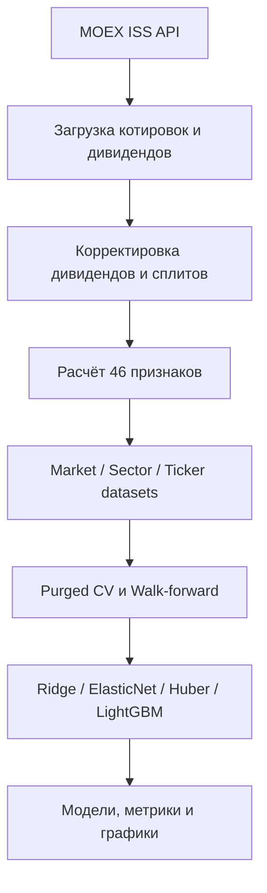

# ML Stocks Analysis

## Эксперимент: ранг, доходность и возможность оставаться в деньгах

На одинаковых development-датах сравнили четыре варианта. При 10 б.п. на сторону
ранг дал **−4.86%**, прогноз абсолютной доходности — **−28.91%**, доходность с
фильтром входа — **−17.00%**, ранг с тем же фильтром — **−1.67%**. Это суммарные
price-only результаты за 03.01.2024–06.05.2026. Во всех вариантах пропущенная
доля остаётся в деньгах; поэтому база отличается от прежних −3.97%.

Гибрид выиграл лишь в 9/28 месяцев, неопределённость включает ноль, а отмеченная
просадка увеличилась с31.66% до35.49%. Прогноз доходности плохо откалиброван и
по MSE уступил историческому среднему. Ранг остаётся baseline; устойчивого
преимущества гибрида и прибыльной стратегии не подтверждено. **95 тестов проходят.**

[Протокол, калибровка, сравнение и ограничения](experiments/asof_baseline/RANK_RETURN_RESULTS.md).

## Новая итерация: корпоративная история и снижение оборота

Ранговая модель сохранена без переобучения. В одном движке с исполнением на
следующем открытии правило «вход top-5, удержание до выхода из top-10» снизило
оборот на **65.90%** относительно ежедневного top-5. За 03.01.2024–06.05.2026
результат при 10 б.п. на каждую сторону изменился с **−25.47% до −3.97%**;
без издержек — с +8.76% до +9.28%. Это преимущественно экономия издержек.
Доходности остаются price-only и исследовательскими, прибыльность не подтверждена.

Восстановлены котировки RAGR/FIXR и отдельный сценарий успешно завершённых
преобразований AGRO/FIXP. Он закрывает восемь ранее зависших позиций в
равновзвешенном диагностическом портфеле. Для TCSG → T отдельно возвращена
181 сессия одной и той же ценной бумаги; текущая модель ещё не переобучалась
на этой истории. Для OZON явно отмечены позиции, требующие успешной конвертации.

Дивидендный ledger содержит **88 событий по 11 из 35 бумаг**; полное покрытие
есть только внутри проверенных интервалов. PHOR/HYDR проверены до конца 2025,
остальные девять — до 06.11.2026. В панели известны дивиденды для **11 483 из
35 662** завершённых меток. Неизвестные выплаты остаются NaN, полный
портфель с дивидендами ещё не рассчитан. Тесты проверяют денежный учёт,
запрет новых покупок старых расписок, календарь и единицы дивидендов.

Правила, все пять фаз редкого пересмотра, ограничения, происхождение данных и
команды: [результаты третьей итерации](experiments/asof_baseline/ROUND3_RESULTS.md).

## Исследовательский baseline, 10.11.2026

`experiments/asof_baseline/` использует дневные OHLCV и причинные признаки для
решения после закрытия: вход на следующем открытии, выход на пятом закрытии.
Исправлены учёт остановок торгов, сплит T 1:10 от 17.04.2026
([MOEX](https://www.moex.com/n99355)), проверка скачков через пропуски и
неявное заполнение цен в momentum. Прогнозы строятся для всех допустимых на
дату решения бумаг, даже когда будущие котировки отсутствуют. Обучение и
условные IC-метрики используют только завершённые доступные исходы.

### Текущий результат

На одинаковых 590 development-днях, 19 499 прогнозах, признаках и месячном
переобучении Ridge на двух годах получено:

| Таргет | Средний дневной IC |
| --- | ---: |
| Пятисессионная доходность минус IMOEX | 0.06559 |
| Ранг этой доходности среди бумаг одной даты | **0.09466** |
| Доходность / известная на дату решения волатильность | 0.06870 |

Ранговый таргет: `(rank - 1) / (n - 1) - 0.5`; прогноз является скором для
ранжирования, не процентом ожидаемой доходности. Его разница IC с excess
положительна в 20/28 месяцев; месячный bootstrap 95%: [0.01293, 0.04505].
Это исследовательский результат после выбора нескольких вариантов;
он не подтверждён независимым тестом. Состав 35 бумаг ретроспективный.

Портфельный диагностический расчёт за 03.01.2024–06.05.2026: пять денежных
частей, top5, свободные деньги могут повторно инвестироваться, приостановленные
позиции сохраняются до доступного выхода. Для рангового таргета суммарный
price-return **+2.31% без издержек**, **−19.16% при 10 б.п. на каждую сторону**,
**−43.21% при 25 б.п.**. Это гипотетические издержки, дробные акции и исполнение
по OHLC, без дивидендов, налогов и оценки ёмкости. Были устаревшие оценки
при остановках, поэтому просадки и волатильность предварительные.
На исходных котировках у universe-бенчмарка остаются позиции AGRO/FIXP;
выше добавлен отдельный сценарий подтверждённого получения бумаг-преемников.
Рост IC не означает готовую прибыльную стратегию.

### Воспроизведение

CSV должны содержать `TRADEDATE,OPEN,HIGH,LOW,CLOSE,VOLUME,VALUE,WAPRICE,NUMTRADES`
для `TICKERS_SECTORS`, IMOEX и RVI. Подходят raw-файлы из `SSA_targets_20261109`.

```bash
BASELINE_RAW_DIR=/path/to/raw python experiments/asof_baseline/build_panel.py
python -m unittest discover -s experiments/asof_baseline -p 'test_*.py'
python experiments/asof_baseline/run_baseline.py
python experiments/asof_baseline/compare_refit.py
python experiments/asof_baseline/compare_targets.py
python experiments/asof_baseline/portfolio.py
python experiments/asof_baseline/portfolio.py --predictions experiments/asof_baseline/target_development_predictions.parquet --output experiments/asof_baseline/target_portfolio_results
```

Панель, полная сетка цен, прогнозы, дневные NAV, сделки, происхождение каждого
обучения и помесячные сравнения сохраняются рядом со скриптами. 27 проверок
защищают границы обучения, учёт будущих пропусков, сплиты, денежный бюджет,
отложенный выход и расчёт дивидендных меток. Период май–октябрь 2026 был ранее
просмотрен и не используется для нового подбора. Старые результаты до исправления
T и отбора прогнозов по будущим меткам заменены этим пересчётом.

### Дивиденды и дальнейшая работа

`corporate_actions.total_return_labels` принимает проверенные события и явные
интервалы полного покрытия источником; при неизвестном покрытии возвращает NaN.
Учёт права на выплату: `entry_date < ex_date <= exit_date`. Это начисленное
требование для таргета, не немедленно доступные деньги. Полная история для
35 бумаг пока не восстановлена: публичный ISS endpoint не возвращает таблицу.
Договор источников и формат данных: [CORPORATE_ACTIONS.md](experiments/asof_baseline/CORPORATE_ACTIONS.md).

Следующие приоритеты: завершить оставшиеся интервалы дивидендной истории,
интегрировать проверенный сегмент TCSG в новую панель, затем оценить полную
доходность. Исполнение с удержанием до top-10 — текущий кандидат для будущей
проверки на заранее зафиксированном периоде. Ранговый таргет — текущий
кандидат для ранжирования. EMA на общей выборке уступает базе (IC 0.04518
против 0.05433); SSA пока не получила подтверждённого преимущества.

## Исторический pipeline max-High

Следующие разделы описывают исходную версию. `scripts/train_models.py` и
`scripts/train_processed_models.py` оставлены для воспроизведения исторических
результатов. Их pooled IC и подбор по всей истории не подтверждают качество
нового baseline. Старый сборщик дивидендно-скорректированных данных намеренно
останавливается при отсутствии проверенного источника выплат и ex-date.

Исследовательский ML-пайплайн для прогнозирования максимальной потенциальной доходности ликвидных акций Московской биржи на горизонте пяти торговых дней.

> Проект предназначен для исследований и обучения. Результаты моделей не являются инвестиционной рекомендацией и не учитывают комиссии, проскальзывание, ликвидность позиции и иные реальные ограничения торговли.

## Что делает проект

Пайплайн автоматически:

1. загружает котировки, дивиденды и рыночные индикаторы из бесплатного MOEX ISS API;
2. корректирует цены на дивиденды и обнаруженные сплиты;
3. рассчитывает 46 технических, моментумных, риск- и ликвидностных признаков;
4. формирует выборки уровня рынка, сектора и отдельного тикера;
5. нормализует признаки без использования будущей информации;
6. обучает линейные и нелинейные модели;
7. оценивает их через purged cross-validation и walk-forward validation;
8. сохраняет модели, таблицы метрик и графики.

Целевая переменная:

```text
target[t] = max(ADJ_HIGH[t+1], ..., ADJ_HIGH[t+5]) / ADJ_CLOSE[t] - 1
```

Она показывает максимальный рост скорректированной цены, который мог быть достигнут в следующие пять торговых дней.

## Архитектура



Подробности: [docs/architecture.md](docs/architecture.md).

## Структура репозитория

```text
.
├── src/ml_stocks_analysis/
│   ├── data_pipeline.py       # основной сбор и подготовка датасетов
│   ├── training.py            # обучение на исходных датасетах
│   └── training_processed.py  # обучение на очищенных датасетах
├── scripts/
│   ├── build_datasets.py
│   ├── train_models.py
│   └── train_processed_models.py
├── legacy/
│   └── build_datasets_legacy.py
├── data/processed/            # очищенные датасеты и metadata.json
├── datasets/                  # исходные сгенерированные датасеты
├── models/                    # модели исходного пайплайна
├── models_processed/          # модели обработанного пайплайна
├── results/                   # метрики и визуализации, если сгенерированы
├── requirements.txt
└── CLAUDE.md
```

Каталоги с данными, моделями и результатами являются воспроизводимыми артефактами. Новые артефакты исключены через `.gitignore`; уже закоммиченные файлы сохранены, чтобы не потерять результаты экспериментов.

## Требования

- Python 3.11 или новее;
- интернет-доступ к `iss.moex.com`;
- достаточно оперативной памяти для объединённой рыночной панели;
- LightGBM может потребовать системные библиотеки компилятора на некоторых платформах.

## Быстрый старт

```bash
git clone https://github.com/Kirillkod2028/ML_Stocks_Analysis.git
cd ML_Stocks_Analysis

python -m venv .venv
```

Активация окружения:

```bash
# macOS / Linux
source .venv/bin/activate

# Windows PowerShell
.venv\Scripts\Activate.ps1
```

Установка зависимостей:

```bash
python -m pip install --upgrade pip
pip install -r requirements.txt
```

## Запуск

### 1. Построение датасетов

```bash
python scripts/build_datasets.py
```

Скрипт загружает данные начиная с `2021-01-01`, рассчитывает признаки и сохраняет наблюдения начиная с `2022-08-01`.

Основные выходы:

```text
datasets/
├── market/dataset_market.parquet
├── sectors/dataset_{SECTOR}.parquet
└── tickers/dataset_{TICKER}.parquet
```

### 2. Обучение моделей

На исходных выборках:

```bash
python scripts/train_models.py
```

На предварительно очищенных выборках из `data/processed/`:

```bash
python scripts/train_processed_models.py
```

Обучение может занимать продолжительное время: Optuna подбирает гиперпараметры отдельно для нескольких моделей и наборов данных.

## Данные

Источник — [MOEX ISS](https://iss.moex.com/), авторизация не требуется.

Пайплайн использует:

- дневные OHLCV-данные акций режима TQBR;
- дивидендные события;
- индекс IMOEX;
- курс USD/RUB;
- индекс волатильности RVI.

В текущей конфигурации используются 35 тикеров, распределённых по нефтегазовому, финансовому, металлургическому, потребительскому, телекоммуникационному, энергетическому, IT, строительному и прочим секторам.

## Признаки

Всего рассчитывается 46 признаков:

- momentum: доходности 1/5/21/63/126 дней, 12–1 momentum, TSMOM;
- mean reversion: расстояния до средних, RSI, Williams %R, Bollinger %B;
- volatility: realized, Garman–Klass, Parkinson, Rogers–Satchell, Yang–Zhang, ATR;
- volume and liquidity: z-score объёма, Amihud illiquidity, OBV, turnover;
- technical: MACD, stochastic oscillator, ADX, CCI, EMA и Donchian;
- market-relative: beta к IMOEX, относительная сила, idiosyncratic volatility;
- macro/calendar: USD/RUB beta, RVI, день недели, месяц и дивидендные признаки.

Непрерывные признаки нормализуются отдельно для рыночных, секторных и тикерных выборок. Категориальные и знаковые признаки не масштабируются как обычные непрерывные величины.

## Модели

Поддерживаются:

- Ridge;
- ElasticNet;
- HuberRegressor;
- LightGBM.

Каждый сохранённый `.pkl` содержит словарь, а не только estimator:

```python
import joblib

bundle = joblib.load("models/market_LightGBM.pkl")
pipeline = bundle["pipeline"]
features = bundle["features"]
predictions = pipeline.predict(X[features])
```

## Валидация и защита от утечки

Проект использует временную валидацию:

- `PurgedKFold` с purge и embargo по пять дней;
- expanding-window `WalkForwardCV`;
- подбор гиперпараметров по средней Spearman Information Coefficient;
- расчёт кросс-секционной IC отдельно по датам для панельных данных.

Несмотря на эти меры, перед практическим использованием необходимо отдельно проверить survivorship bias, качество корпоративных событий, торговые издержки, доступность цены исполнения и стабильность результатов вне выборки.

## Воспроизводимость

Для полного воспроизведения эксперимента рекомендуется:

1. зафиксировать дату окончания выборки;
2. сохранить версии Python и зависимостей;
3. записать random seed Optuna и моделей;
4. не сравнивать варианты по одному и тому же финальному holdout;
5. хранить конфигурацию эксперимента рядом с метриками и моделью.

## Известные ограничения

- Вселенная тикеров задаётся вручную и отражает текущий состав исследования.
- MOEX ISS может пересматривать исторические данные.
- Эвристическое обнаружение сплитов требует ручной проверки необычных ценовых разрывов.
- Цель описывает максимальную будущую цену, но сама по себе не задаёт реализуемую торговую стратегию.
- В репозитории пока остаются крупные исторические артефакты моделей и датасетов.
- Для нового baseline добавлены focused tests; отдельный CI пока не настроен.

## Следующие разумные шаги

- вынести константы и список тикеров в конфигурационный YAML;
- разделить крупные модули на клиент MOEX, feature engineering, datasets и training;
- расширять существующие тесты по мере интеграции новых источников;
- расширить текущий backtest полной дивидендной историей и моделью исполнения;
- подключить MLflow или другую систему учёта экспериментов;
- хранить большие артефакты в DVC, Git LFS или объектном хранилище.

## Лицензия

Лицензия пока не указана. До её добавления исходный код следует считать доступным для просмотра, но не автоматически разрешённым для распространения или коммерческого переиспользования.
