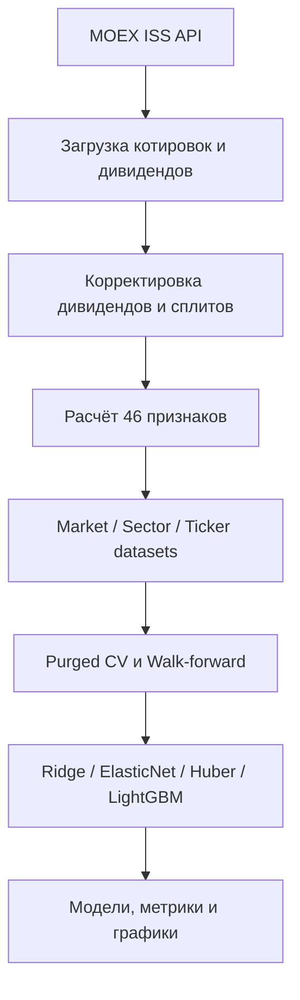

# ML Stocks Analysis

## Исследовательский baseline после аудита 10.11.2026

`experiments/asof_baseline/` строит отдельную панель из сохранённых дневных
OHLCV-файлов и проверяет Ridge на **исполнимом пятисессионном price-return**:
решение после закрытия, вход на следующем открытии, выход через пять сессий.
Обучение использует excess относительно IMOEX; дневное ранжирование проверяется
на доходности бумаг. Дивиденды пока не включены и не приравниваются к нулю.

Данные нужны в CSV `TRADEDATE,OPEN,HIGH,LOW,CLOSE,VOLUME,VALUE,WAPRICE,NUMTRADES`
для тикеров из `TICKERS_SECTORS`, а также IMOEX и RVI. Подходят сохранённые
исходные файлы из архива эксперимента `SSA_targets_20261109`. После их распаковки:

```bash
BASELINE_RAW_DIR=/path/to/raw python experiments/asof_baseline/build_panel.py
python experiments/asof_baseline/test_integrity.py
python experiments/asof_baseline/run_baseline.py
```

Результаты `development_summary.csv` сопоставляют базу и EMA на одинаковых
строках; отдельная `base_full` показывает покрытие без требования истории EMA.
Используются только временные folds до 07.05.2026 с очисткой перекрывающихся
меток; период с мая по октябрь 2026 уже просмотрен и не используется для нового
подбора. Таблицы относительных доходностей пятисессионных когорт не равны
реализованной доходности портфеля после издержек.

Старые `scripts/train_models.py` и `scripts/train_processed_models.py` ниже
оставлены для воспроизведения исторических результатов по максимуму High.
Их pooled IC и подбор по всей истории нельзя использовать как подтверждение
качества нового baseline. Старый `build_datasets.py` теперь останавливается,
если источник дивидендов не возвращает ожидаемую таблицу, вместо молчаливого
объявления неизвестных выплат отсутствующими. Источник и календарь ex-date
нужно восстановить до обучения на полной доходности.

Исследовательский ML-пайплайн для прогнозирования максимальной потенциальной доходности ликвидных акций Московской биржи на горизонте пяти торговых дней.

> Проект предназначен для исследований и обучения. Результаты моделей не являются инвестиционной рекомендацией и не учитывают комиссии, проскальзывание, ликвидность позиции и иные реальные ограничения торговли.

## Что делает проект

Пайплайн автоматически:

1. загружает котировки, дивиденды и рыночные индикаторы из бесплатного MOEX ISS API;
2. корректирует цены на дивиденды и обнаруженные сплиты;
3. рассчитывает 46 технических, моментумных, риск- и ликвидностных признаков;
4. формирует выборки уровня рынка, сектора и отдельного тикера;
5. нормализует признаки без использования будущей информации;
6. обучает линейные и нелинейные модели;
7. оценивает их через purged cross-validation и walk-forward validation;
8. сохраняет модели, таблицы метрик и графики.

Целевая переменная:

```text
target[t] = max(ADJ_HIGH[t+1], ..., ADJ_HIGH[t+5]) / ADJ_CLOSE[t] - 1
```

Она показывает максимальный рост скорректированной цены, который мог быть достигнут в следующие пять торговых дней.

## Архитектура



Подробности: [docs/architecture.md](docs/architecture.md).

## Структура репозитория

```text
.
├── src/ml_stocks_analysis/
│   ├── data_pipeline.py       # основной сбор и подготовка датасетов
│   ├── training.py            # обучение на исходных датасетах
│   └── training_processed.py  # обучение на очищенных датасетах
├── scripts/
│   ├── build_datasets.py
│   ├── train_models.py
│   └── train_processed_models.py
├── legacy/
│   └── build_datasets_legacy.py
├── data/processed/            # очищенные датасеты и metadata.json
├── datasets/                  # исходные сгенерированные датасеты
├── models/                    # модели исходного пайплайна
├── models_processed/          # модели обработанного пайплайна
├── results/                   # метрики и визуализации, если сгенерированы
├── requirements.txt
└── CLAUDE.md
```

Каталоги с данными, моделями и результатами являются воспроизводимыми артефактами. Новые артефакты исключены через `.gitignore`; уже закоммиченные файлы сохранены, чтобы не потерять результаты экспериментов.

## Требования

- Python 3.11 или новее;
- интернет-доступ к `iss.moex.com`;
- достаточно оперативной памяти для объединённой рыночной панели;
- LightGBM может потребовать системные библиотеки компилятора на некоторых платформах.

## Быстрый старт

```bash
git clone https://github.com/Kirillkod2028/ML_Stocks_Analysis.git
cd ML_Stocks_Analysis

python -m venv .venv
```

Активация окружения:

```bash
# macOS / Linux
source .venv/bin/activate

# Windows PowerShell
.venv\Scripts\Activate.ps1
```

Установка зависимостей:

```bash
python -m pip install --upgrade pip
pip install -r requirements.txt
```

## Запуск

### 1. Построение датасетов

```bash
python scripts/build_datasets.py
```

Скрипт загружает данные начиная с `2021-01-01`, рассчитывает признаки и сохраняет наблюдения начиная с `2022-08-01`.

Основные выходы:

```text
datasets/
├── market/dataset_market.parquet
├── sectors/dataset_{SECTOR}.parquet
└── tickers/dataset_{TICKER}.parquet
```

### 2. Обучение моделей

На исходных выборках:

```bash
python scripts/train_models.py
```

На предварительно очищенных выборках из `data/processed/`:

```bash
python scripts/train_processed_models.py
```

Обучение может занимать продолжительное время: Optuna подбирает гиперпараметры отдельно для нескольких моделей и наборов данных.

## Данные

Источник — [MOEX ISS](https://iss.moex.com/), авторизация не требуется.

Пайплайн использует:

- дневные OHLCV-данные акций режима TQBR;
- дивидендные события;
- индекс IMOEX;
- курс USD/RUB;
- индекс волатильности RVI.

В текущей конфигурации используются 35 тикеров, распределённых по нефтегазовому, финансовому, металлургическому, потребительскому, телекоммуникационному, энергетическому, IT, строительному и прочим секторам.

## Признаки

Всего рассчитывается 46 признаков:

- momentum: доходности 1/5/21/63/126 дней, 12–1 momentum, TSMOM;
- mean reversion: расстояния до средних, RSI, Williams %R, Bollinger %B;
- volatility: realized, Garman–Klass, Parkinson, Rogers–Satchell, Yang–Zhang, ATR;
- volume and liquidity: z-score объёма, Amihud illiquidity, OBV, turnover;
- technical: MACD, stochastic oscillator, ADX, CCI, EMA и Donchian;
- market-relative: beta к IMOEX, относительная сила, idiosyncratic volatility;
- macro/calendar: USD/RUB beta, RVI, день недели, месяц и дивидендные признаки.

Непрерывные признаки нормализуются отдельно для рыночных, секторных и тикерных выборок. Категориальные и знаковые признаки не масштабируются как обычные непрерывные величины.

## Модели

Поддерживаются:

- Ridge;
- ElasticNet;
- HuberRegressor;
- LightGBM.

Каждый сохранённый `.pkl` содержит словарь, а не только estimator:

```python
import joblib

bundle = joblib.load("models/market_LightGBM.pkl")
pipeline = bundle["pipeline"]
features = bundle["features"]
predictions = pipeline.predict(X[features])
```

## Валидация и защита от утечки

Проект использует временную валидацию:

- `PurgedKFold` с purge и embargo по пять дней;
- expanding-window `WalkForwardCV`;
- подбор гиперпараметров по средней Spearman Information Coefficient;
- расчёт кросс-секционной IC отдельно по датам для панельных данных.

Несмотря на эти меры, перед практическим использованием необходимо отдельно проверить survivorship bias, качество корпоративных событий, торговые издержки, доступность цены исполнения и стабильность результатов вне выборки.

## Воспроизводимость

Для полного воспроизведения эксперимента рекомендуется:

1. зафиксировать дату окончания выборки;
2. сохранить версии Python и зависимостей;
3. записать random seed Optuna и моделей;
4. не сравнивать варианты по одному и тому же финальному holdout;
5. хранить конфигурацию эксперимента рядом с метриками и моделью.

## Известные ограничения

- Вселенная тикеров задаётся вручную и отражает текущий состав исследования.
- MOEX ISS может пересматривать исторические данные.
- Эвристическое обнаружение сплитов требует ручной проверки необычных ценовых разрывов.
- Цель описывает максимальную будущую цену, но сама по себе не задаёт реализуемую торговую стратегию.
- В репозитории пока остаются крупные исторические артефакты моделей и датасетов.
- Автоматические тесты и CI ещё не добавлены.

## Следующие разумные шаги

- вынести константы и список тикеров в конфигурационный YAML;
- разделить крупные модули на клиент MOEX, feature engineering, datasets и training;
- добавить unit-тесты для target, dividend adjustment, split handling и CV;
- добавить backtest с комиссиями и проскальзыванием;
- подключить MLflow или другую систему учёта экспериментов;
- хранить большие артефакты в DVC, Git LFS или объектном хранилище.

## Лицензия

Лицензия пока не указана. До её добавления исходный код следует считать доступным для просмотра, но не автоматически разрешённым для распространения или коммерческого переиспользования.
